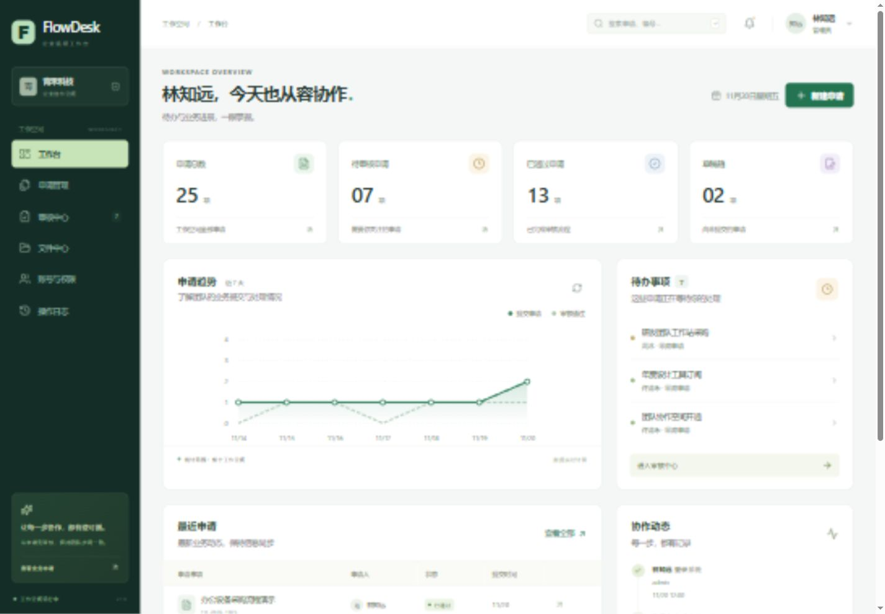

# FlowDesk · 企业流程工作台

一个围绕 **业务申请 → 审核流转 → 文件协作 → 账号权限** 的完整前后端项目。用于展示复杂中后台的业务建模、配置化表单、角色权限和大文件上传能力。




## 开始体验

建议 Node.js 22 LTS；兼容 Node.js 18.18 及以上。

```bash
npm ci
npm run dev
```

打开 **http://127.0.0.1:5173**。Vite 为前端提供热更新，Express 在 3001 端口处理 API。无需外部数据库、云服务账号或 API Key。

| 角色 | 账号 | 密码 | 可体验内容 |
| --- | --- | --- | --- |
| 管理员 | admin | Demo@123456 | 全部申请、审核、成员管理、操作日志 |
| 审核员 | reviewer | Demo@123456 | 全部申请、审核通过/退回、查看附件 |
| 业务专员 | operator | Demo@123456 | 本人申请、动态表单、草稿、文件上传 |
| 另一位专员 | operator2 | Demo@123456 | 用于验证不同用户的数据隔离 |

演示企业、人员、业务材料均为虚构数据。首次启动自动创建演示账号及 24 条业务申请；后续启动保留实际修改。

## 已完成的功能

- **工作台**：真实统计、最近七天趋势、待办申请、协作动态。
- **申请管理**：搜索、状态/类型筛选、排序、分页、CSV 导出、详情和附件下载。
- **审核流程**：草稿、提交、退回、修改重提、通过；审核意见和完整流转记录。
- **配置化表单**：企业/个人主体联动、采购预算联动、日期范围校验、企业信用代码远程重复校验。
- **草稿恢复**：IndexedDB 按账号和申请隔离，600 ms 防抖自动保存；手动保存进入服务端草稿箱。
- **大文件上传**：Web Worker 计算 MD5、2 MB 分片、每文件最多 3 个请求并发、文件任务顺序调度、暂停/恢复、刷新后续传、秒传、服务端合并校验。
- **角色权限**：根据权限注册路由和菜单，`v-permission` 控制按钮，预算列表列按角色显示；接口再次校验角色与资源归属。
- **成员管理**：新增成员、角色变更、启停账号；变更后使原登录会话失效。
- **工程交付**：TypeScript 构建、接口测试、浏览器测试、GitHub Actions、Docker、架构和面试说明。

## 三分钟演示路线

1. 用 `operator` 登录，打开「新建申请」。切换个人/企业主体，输入 25,000 元，观察字段联动。
2. 填写后刷新页面，点击恢复草稿；完善日期、说明和预算依据，提交申请。
3. 换 `reviewer` 登录，在审核中心退回申请并写明原因；专员修改重提，审核员确认通过。
4. 打开文件中心，上传一个大文件，暂停后继续；刷新并重新选择同一原文件验证续传，再选一次验证秒传。
5. 用 `admin` 查看成员管理和操作日志，对比三个角色的导航、按钮和预算列表列。

## 运行与验证

```bash
npm test          # 接口与领域规则测试
npm run build     # Vue/服务端类型检查与生产构建
npm start         # 同源生产服务，打开 http://localhost:3001
```

浏览器自动化测试使用独立的 `.e2e-data/` 数据目录，不修改开发数据：

```bash
npm run build
npx playwright install chromium
npm run test:e2e
```

GitHub Actions 自动执行构建、测试和依赖扫描，浏览器失败截图、trace 和报告保存在工作流附件中。

## 技术栈与目录

前端：**Vue 3 + TypeScript + Vite + Pinia + Vue Router + IndexedDB + 原生 CSS**。采用自定义组件与设计系统，图标来自 Lucide。后端：**Express + SQLite（sql.js）+ Zod + bcryptjs + Multer**。

```text
src/
  components/       工作台布局、Schema 渲染、上传队列、附件选择等
  pages/            登录、工作台、申请、审核、文件、成员和日志
  stores/           登录状态、上传调度、全局提示
  lib/              API、表单配置、IndexedDB 草稿
  workers/          独立线程文件 MD5
shared/             领域类型、权限表、业务规则、服务端输入 Schema
server/             API、身份验证、数据库、上传合并与校验
tests/              接口/领域规则测试和浏览器端到端测试
docs/               项目梳理、架构、面试准备、部署说明、截图
```

## 项目说明

- [项目内容梳理](docs/项目内容梳理.md)
- [架构与技术取舍](docs/架构说明.md)
- [面试讲解与追问](docs/面试准备.md)
- [部署说明](docs/部署说明.md)

## 部署边界

这是可完整运行的个人项目，采用 **单进程、本地持久化 SQLite**，没有宣称经过生产高并发验证。它不能仅上传到 GitHub Pages、Netlify 或 Vercel 的静态托管后就运行全部功能；需要能够运行 Node.js 且提供持久化磁盘的环境。

演示模式包含公开的快捷登录账号。私有部署前在**全新数据目录**设置 `DEMO_MODE=false` 和至少 12 位的 `ADMIN_PASSWORD`，并在 HTTPS 环境开启 `COOKIE_SECURE=true`。关闭演示模式不会自动删除已有演示账号。

MD5 用于演示文件指纹、误码检测与续传，不作为抗恶意碰撞的密码学保证。上传存储、生产监控、配额与备份等边界见部署说明。
