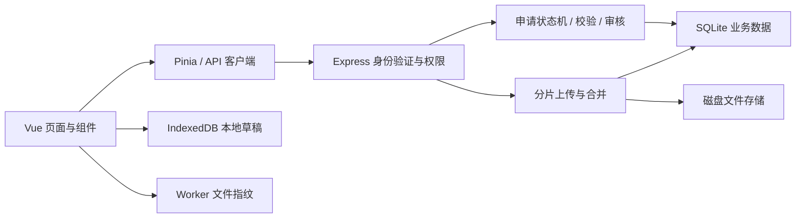
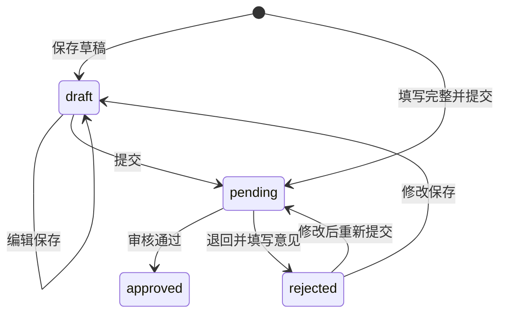
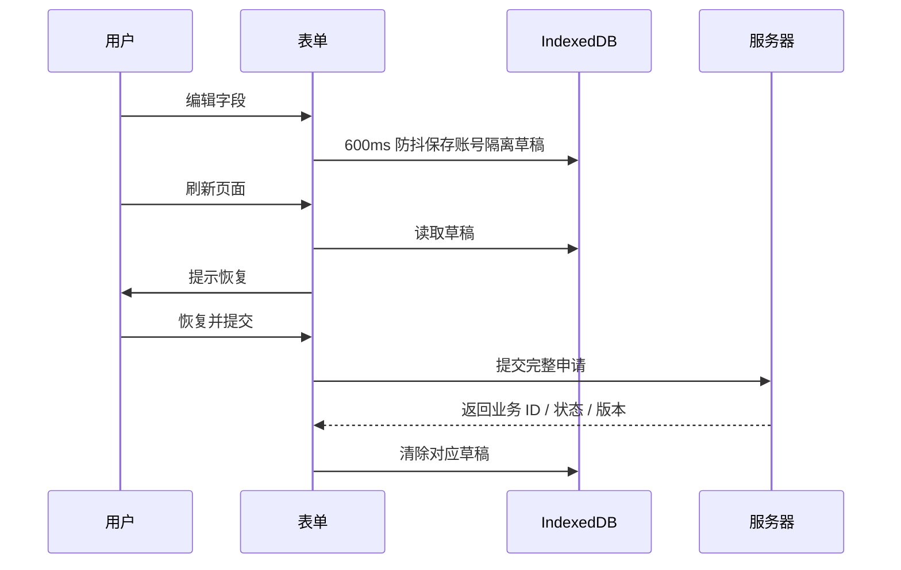
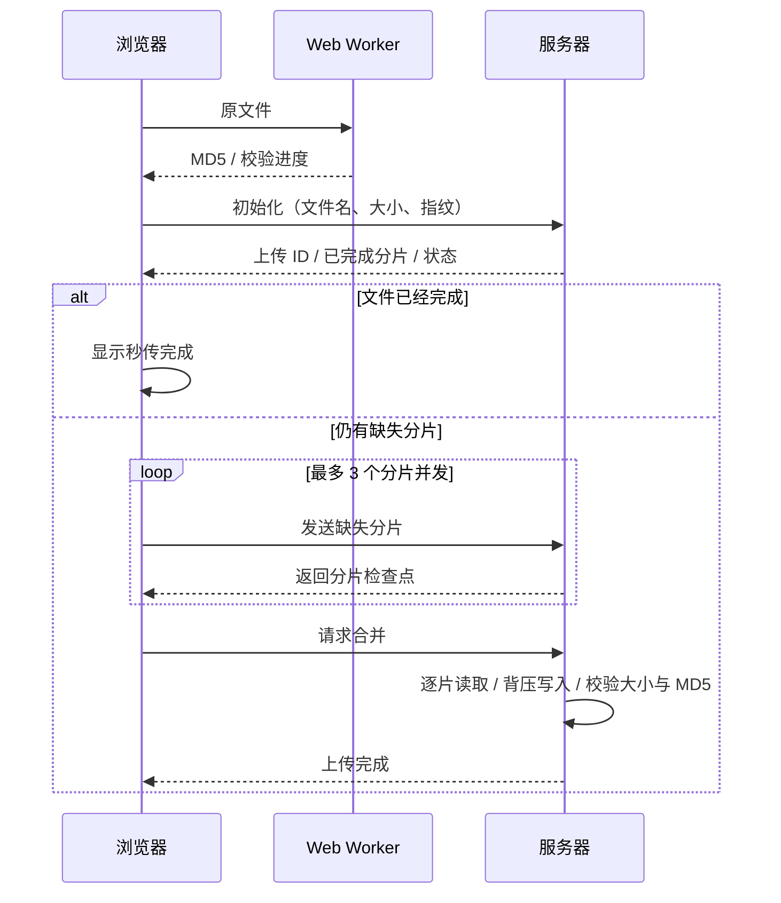

# 架构与技术取舍

## 系统边界

开发模式由 Vite 代理 `/api` 到 Express，保留原始 Host，使 Origin 检查正确。生产构建后 Express 同时提供前端静态文件和 API，保持同源。

## 权限不是只隐藏按钮

1. 服务端登录成功后返回用户、角色和能力列表。会话使用随机 32 字节令牌，只把令牌的 SHA-256 摘要存入数据库；浏览器接收 HttpOnly、SameSite=Lax Cookie。
2. 前端根据能力表 `addRoute` 注册允许访问的页面，导航读取同一份权限表。登录、退出时重建动态路由。
3. `v-permission` 隐藏无权限按钮，列表使用权限条件决定是否显示预算列。
4. 每次 API 请求从有效会话重新查询角色。业务专员查询申请时按 `owner_id` 限制；详情和文件接口也检查资源归属，防止猜 ID 访问。
5. 权限变更和账号停用删除目标用户全部会话，使下一次请求立即失效。修改账号的管理员不能降级或停用自己；系统至少保留一位有效管理员。

前端能力表改善体验，服务端验证形成实际边界。预算列表列隐藏是一种信息展示差异；专员自己的申请仍包含预算，不应把这项描述为字段级数据保密。

## 申请状态与并发冲突

`pending` 和 `approved` 不允许申请人直接修改。审核员不能审核自己的申请。

每份申请带 `version`。客户端更新与审核发送读到的版本，服务器要求状态和版本都仍匹配，否则返回 409，避免不同标签页静默覆盖。

本项目单进程执行 SQL，检查与事务写入之间没有异步等待；服务端事件循环保证这段执行不会被另一条写请求插入。若迁移到多进程/独立数据库，应改为带 `WHERE version=? AND status=?` 的原子 UPDATE 并检查影响行数，不能继续依赖单进程前提。

审核记录、申请更新、操作日志在同一 SQLite 事务内提交。数据库通过 sql.js 在内存执行，修改事务后导出到临时文件，再重命名为实际文件。

## 为什么选择 sql.js

跨平台启动无需编译原生 SQLite 扩展，适合面试演示和开箱即用。数据保存在 `data/flowdesk.sqlite`，上传内容在 `data/uploads/`。

代价是每次写入都导出整个数据库，并且数据库主体驻留内存。本版列表筛选也在读出可见记录后执行，没有宣称适合百万记录或高写入并发。扩大数据规模时应换成原生 SQLite/PostgreSQL、SQL 分页筛选、索引与连接池，并对部署模式做压测。

## 配置化表单与异步校验

表单配置描述字段类型、名称、提示、选项、必填标识、整行布局与显示条件。基础业务字段和配置字段共用 `RequestForm`。

本版的“Schema 驱动”指开发者在 JSON 文件中配置，不是完整 JSON Schema 实现。配合 TypeScript 类型维护配置与渲染器，没有执行用户传入的任意表达式。

`submissionErrors` 为前后端共用的业务规则；服务端另外使用 Zod 限制输入类型、枚举、字符串长度、金额、日期和附件 UUID。校验模块与领域类型拆开，避免前端基础包加载不需要的服务端 Schema 运行时。

信用代码异步校验在字段失焦时请求；字段变化会取消旧请求，提交前再次检查。最终是否允许提交仍由服务端决定。

## 草稿数据流

本地保存通过 Promise 链顺序执行，避免旧快照比新快照更晚落库。离开页面前刷新待保存草稿；本地存储失败时提示用户手动保存。

## 上传时序

文件任务顺序调度；当前文件使用三个 Worker 函数领取缺失分片下标。每片网络或服务端 5xx 失败最多尝试三次，400/403 等业务错误不会盲目重试。暂停使用 AbortController，恢复重新初始化，以服务端检查点为准。

`chunks` 只在磁盘分片写入后记录，重复发送同一索引覆盖对应分片，集合去重。合并时用进程内锁阻止同一文件的重复合并及同时写入；验证失败清空错误分片检查点，允许原文件重传。

文件名只用于显示和下载，磁盘目录使用服务器生成的 UUID。用户上传 HTML/SVG 等内容也只以 attachment 下载，不作为网站页面执行。

前端 Blob 切片没有把整个文件读进主线程内存；Worker 也按片读取。服务端使用 Multer 内存接收一个分片，再用流合并完整文件，没有把 200 MB 文件整体拼进内存。

MD5 是文件指纹和传输误码检测方案，不是抗恶意碰撞或文件真实性认证。生产方案可以使用 SHA-256、对象存储 Multipart Upload 和配额管理。

## 接口概览

| 方法与路径                          | 功能                 | 权限                 |
| ----------------------------------- | -------------------- | -------------------- |
| POST /api/auth/login                | 登录和建立会话       | 公开                 |
| GET /api/auth/me                    | 恢复当前用户         | 登录                 |
| POST /api/auth/logout               | 注销会话             | 登录                 |
| GET /api/dashboard                  | 统计、待办、动态     | 工作台               |
| GET/POST /api/requests              | 列表、创建/提交      | 查看/创建申请        |
| GET/PUT /api/requests/:id           | 详情、编辑/重提      | 资源可见且本人可编辑 |
| POST /api/requests/:id/review       | 通过或退回           | 审核能力且非本人申请 |
| GET /api/validate/company           | 信用代码备案重复校验 | 创建申请             |
| GET /api/files                      | 可见文件             | 文件能力             |
| POST /api/uploads/init              | 建立任务或读取检查点 | 文件能力             |
| POST /api/uploads/:id/chunks/:index | multipart 字段 chunk | 文件能力且本人任务   |
| POST /api/uploads/:id/complete      | 合并、校验、完成     | 文件能力且本人任务   |
| GET /api/files/:id/download         | 下载完成文件         | 文件可见             |
| GET/POST /api/users                 | 成员列表、创建成员   | 管理员               |
| PATCH /api/users/:id                | 角色和启停           | 管理员               |
| GET /api/audit                      | 搜索操作记录         | 管理员               |

所有失败返回 `{ message, fields? }`，业务冲突为 409，表单业务规则错误为 422。列表参数有固定枚举和页大小上限。
